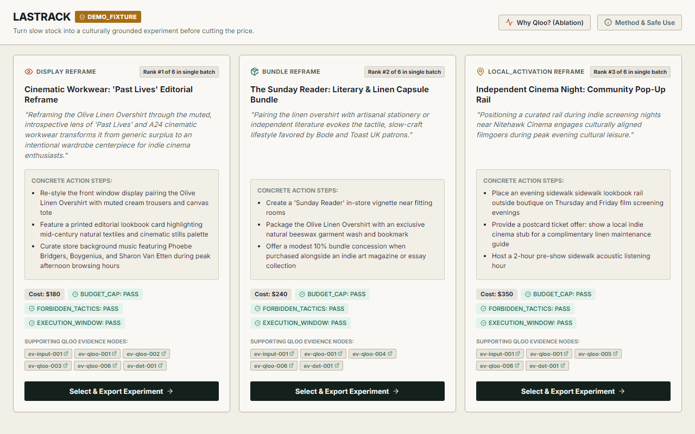
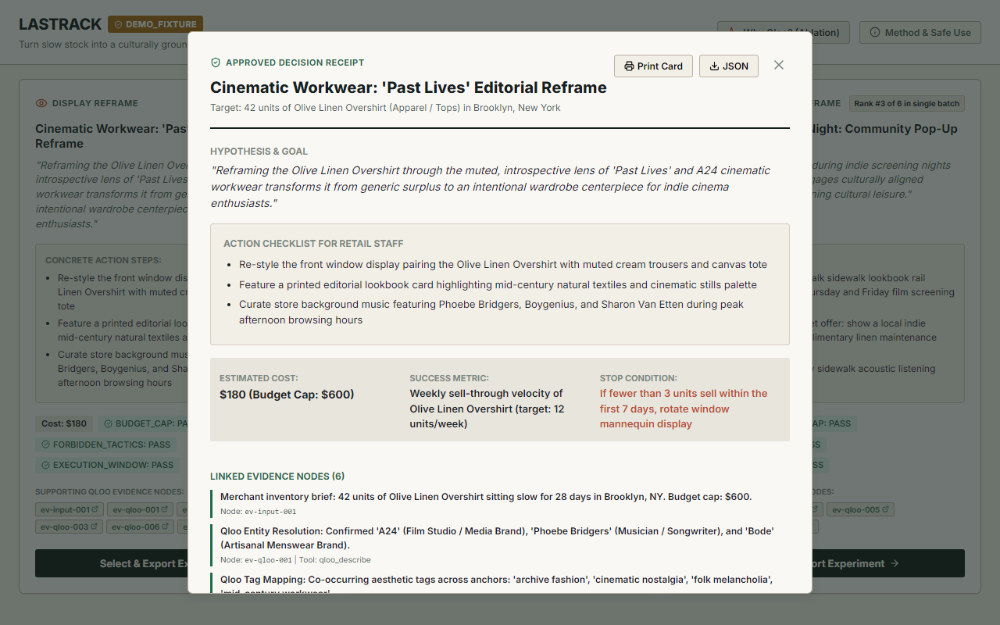
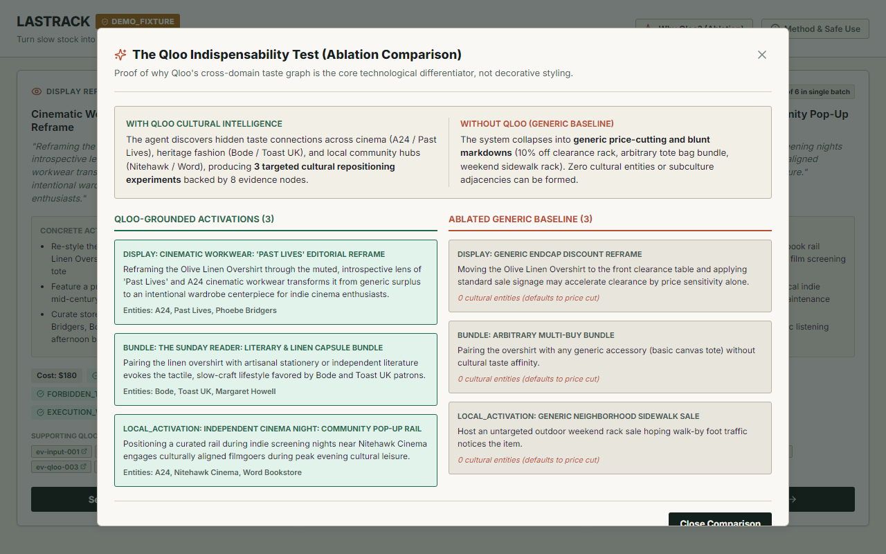
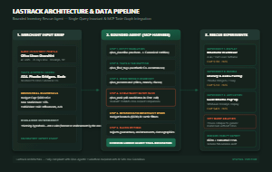
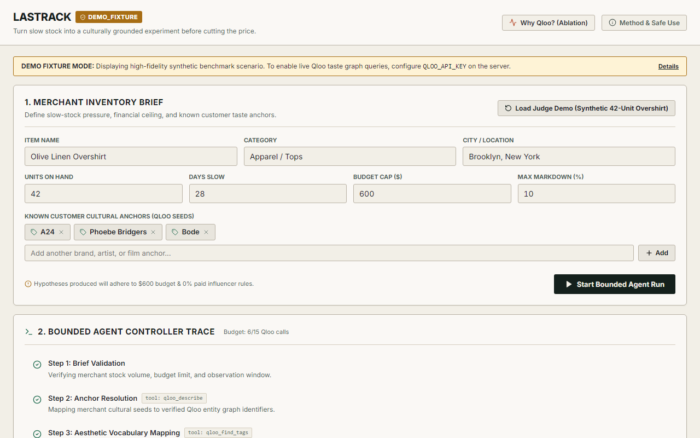
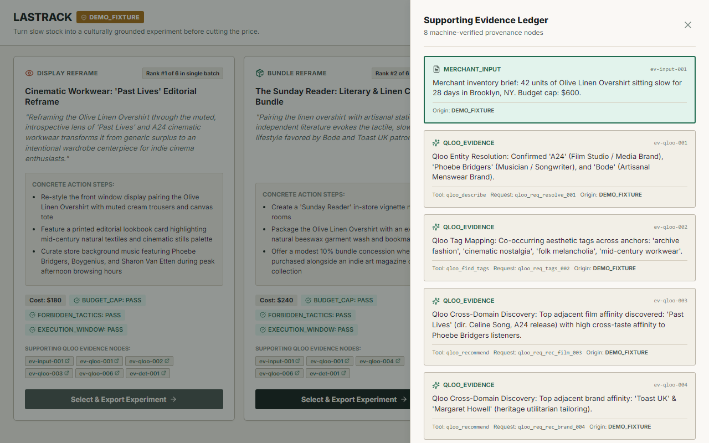
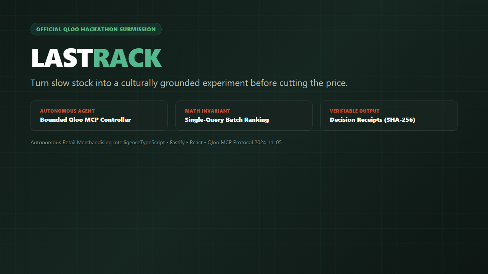

# LastRack

> Before discounting slow inventory, LastRack uses Qloo cultural intelligence to design small, evidence-linked merchandising experiments—and shows exactly what becomes generic when Qloo is removed.

[](tests/)
[](tests/e2e/)
[-1F6B4F?style=flat-square)](tests/e2e/accessibility.spec.ts)
[-1F6B4F?style=flat-square)](scripts/security-scan.cjs)
[](packages/contracts/src/index.ts)
[](LICENSE)

---

## Navigation & Quick Links

- [Live GitHub Repository](https://github.com/abhijeetnardele24-hash/lastrack)
- [Live Judge Demo](https://abhijeetnardele24-hash.github.io/lastrack/) — public `DEMO_FIXTURE` build; no private key required
- [System Architecture](docs/ARCHITECTURE.md)
- [Judge 3-Minute Tour](docs/JUDGE_TOUR.md)
- [Qloo Integration & MCP Contract](docs/QLOO_INTEGRATION.md)
- [Ablation Study ("Why Qloo?")](docs/EVALUATION.md)
- [Safe-Use & Responsible AI Policy](docs/SAFE_USE.md)
- [Video Production Handoff](docs/VIDEO_HANDOFF.md)
- [Devpost Submission Draft](docs/DEVPOST_SUBMISSION.md)
- [Authoritative Verification Results](docs/verification-results.json)

---

## The Problem

Independent apparel merchants face a structural dilemma with unsold stock. When a seasonal garment sits on the rack past 28 days, standard retail management systems offer only one blunt remedy: **mark it down**. 20% off becomes 30%, then 50%. The store bleeds gross margin, trains patrons to wait for clearance racks, and strips the boutique of its editorial point of view.

Yet discounting is frequently an **information failure**, not a product failure. In independent retail, garments are rarely purchased as mere utility—they are bought for aesthetic identity and cultural resonance.

Consider our benchmark scenario:
- **Product:** Olive Linen Overshirt (100% washed European linen, custom horn buttons)
- **Inventory:** 42 units sitting unsold after 28 days
- **Retail Price:** $140 USD
- **Store Location:** Brooklyn, New York

Slashing this piece by 30% burns $1,764 in gross margin without answering the central question: **Why did the customer walk past it?**

The shirt did not fail because olive linen is unappealing; it failed because it sat in visual isolation, stripped of the cultural narrative that makes it relevant to the neighbourhood’s patrons. Traditional retail tools cannot see this because they only track inventory velocity and SKU IDs. They have no vocabulary for cultural affinity.

---

## What LastRack Does

LastRack acts as a bounded merchandising intelligence agent that designs small, evidence-linked retail interventions before a merchant touches the markdown marker.

```
Merchant Brief Input
       │
       ▼
Qloo Cultural Graph (MCP Child Process: Describe → Tags → Recommend → Rank)
       │
       ▼
Deterministic Constraints & Automated Critique Guardrails
       │
       ▼
Three Feasible Merchandising Experiments (Display, Bundle, Local Activation)
       │
       ▼
Evidence Ledger & Decision Receipt with SHA-256 Audit Digest
```

1. **Merchant Brief Intake:** The merchant enters the stagnant SKU, unit count, location, hard budget ceiling (e.g., $600), maximum markdown tolerance (e.g., 10%), prohibited tactics (e.g., no paid social, no demographic profiling), and three cultural seeds that reflect their audience (e.g., *A24*, *Phoebe Bridgers*, *Bode*).
2. **Qloo Taste Graph Exploration:** Over the Model Context Protocol (MCP), LastRack queries Qloo's cultural intelligence layer to ground seeds into canonical entities, identify aesthetic tag co-occurrences, discover cross-domain cultural affinities across cinema, music, and local venues, and rank candidate options.
3. **Three Bounded Experiments:** Formulates three distinct, feasible interventions:
   - **DISPLAY (Visual Merchandising):** Window and styling reframes connecting the garment to cinematic or aesthetic narratives.
   - **BUNDLE (Cross-Category Pairing):** Curated physical pairings with cultural artifacts (literature, audio, provisions).
   - **LOCAL_ACTIVATION (Community Partnership):** Low-cost neighbourhood collaborations with independent venues.
4. **Deterministic Guardrails & Critique:** Enforces the merchant's budget ceiling and execution window, rejecting any proposed tactic exceeding constraints.
5. **Claims Validator:** Rejects sales guarantees, causal demand claims, unauthorized endorsement claims, and individual demographic targeting.
6. **"Why Qloo?" Ablation:** Provides a side-by-side comparison showing what happens when Qloo is removed: the plan collapses into generic clearance endcaps and margin-destroying discounts.
7. **Decision Receipt Export:** Generates an auditable, timestamped HTML and JSON receipt with a SHA-256 checksum and mandatory non-endorsement disclaimer.

> **Important Boundary:** LastRack provides **planning hypotheses**, not sales predictions or demand forecasts. Cultural affinity indicates aesthetic alignment; it does not guarantee commercial transactions.

---

## Demonstration Scenario

Try the public, externally hosted judge build at **[abhijeetnardele24-hash.github.io/lastrack](https://abhijeetnardele24-hash.github.io/lastrack/)**. It deliberately runs in visibly labeled `DEMO_FIXTURE` mode so the complete workflow remains usable without exposing a Qloo API key or implying an unverified live response.

LastRack ships with a preloaded, verified benchmark scenario representing an independent boutique in Brooklyn:

| Scenario Parameter | Value | Rationale |
| :--- | :--- | :--- |
| **Garment** | Olive Linen Overshirt | High-craft seasonal item ($140 retail) vulnerable to premature discounting |
| **Inventory on Hand** | 42 units | Realistic boutique overstock volume |
| **Stagnation Period** | 28 days | Standard threshold before conventional markdowns occur |
| **Boutique Location** | Brooklyn, New York | Geographically distinct subcultural retail market |
| **Merchant Cultural Seeds** | *A24*, *Phoebe Bridgers*, *Bode* | Coherent aesthetic universe (indie cinema, introspective folk, heritage craft) |
| **Budget Cap** | $600 USD total | Realistic operating budget for an independent shop |
| **Maximum Markdown** | 10% | Hard margin boundary; preserves retail price integrity |
| **Forbidden Tactics** | Paid influencer ads, individual demographic targeting | Enforces organic merchandising and ethical customer privacy |

### Generated Merchandising Experiments



1. **DISPLAY — Cinematic Workwear: 'Past Lives' Editorial Reframe**
   - *Estimated Cost:* $180 (within $600 cap)
   - *Markdown:* 0% (full $140 retail preserved)
   - *Mechanism:* Front window restyle framing the overshirt alongside muted vintage tailoring, film stills, and low-contrast linen drape.
   - *Cultural Link:* Qloo affinity connection between *A24* film catalogue and muted workwear aesthetics.

2. **BUNDLE — Literary & Audio Pairings for Solitary Walks**
   - *Estimated Cost:* $250 (within $600 cap)
   - *Markdown:* 0% (paired gift bundle)
   - *Mechanism:* Overshirt bundled with an independent poetry volume and curated vinyl listening slip.
   - *Cultural Link:* Qloo cross-domain co-occurrence between *Phoebe Bridgers* songwriting themes and reflective print literature.

3. **LOCAL_ACTIVATION — Independent Cinema Screening Pop-Up Display**
   - *Estimated Cost:* $420 (within $600 cap)
   - *Markdown:* 0% (partner ticket voucher included with garment purchase)
   - *Mechanism:* Foyer rack pop-up at local independent cinema (*Nitehawk Cinema*) during retrospective weekend.
   - *Cultural Link:* Geographic venue affinity linking Brooklyn cinephiles to boutique craft fashion.

### Decision Receipt Output



Every selected experiment exports as an auditable Decision Receipt containing:
- Full brief parameters and inventory baseline
- Explicit Qloo evidence links with batch IDs and canonical hashes
- Financial constraint adherence certificate
- Deterministic SHA-256 integrity digest
- Mandatory ethical disclaimer:
  > *"Planning hypothesis—not a sales forecast or endorsement by the named entities."*

### What the Qloo-Off Ablation Produces



When Qloo cultural intelligence is disabled, the agent loses access to the taste graph. Without cross-domain affinity data, the system has no storytelling vocabulary and collapses into conventional markdown reflexes:
- Cultural entities discovered: **0** (vs. 3 distinct entities with Qloo)
- Strategy: Generic "Spring Clearance" sidewalk rack and random deadstock bundling
- Price reduction required: **15% to 30% markdown** (destroying up to $1,764 in gross margin)
- Evidence trail: 1 trivial node (merchant inventory count only)

---

## Why Qloo Is Necessary

Qloo provides the cultural graph intelligence that makes non-discount retail interventions possible. Without Qloo, an automated agent has only inventory attributes (material, size, price) and no bridge to the external cultural world.

### Exact Sponsor MCP Integration

LastRack connects directly to the official `@qloo/qloo-harness` (v0.1.26) as an isolated child process over standard input/output (`stdio`), implementing JSON-RPC 2.0 under the `2024-11-05` protocol version:

```
Fastify Server (apps/server)
       │ stdio (JSON-RPC 2.0)
       ▼
@qloo/qloo-harness (node dist/bin.js mcp)
       ├── qloo_capabilities  (Verifies protocol version and available tools)
       ├── qloo_describe      (Resolves merchant cultural seeds to canonical entity IDs)
       ├── qloo_find_tags     (Maps co-occurring aesthetic and thematic descriptors)
       ├── qloo_recommend     (Discovers cross-domain entities across film, music, venues)
       └── qloo_rank          (Evaluates candidate affinity against seed profiles)
```

### The Single-Query Ranking Invariant

A fundamental mathematical reality of Qloo's affinity engine is that **affinity scores represent relative affinity against a specific query set and entity domain**. Comparing scores across separate requests or across disparate domains is mathematically invalid.

LastRack enforces this principle in code (`packages/domain/src/singleQueryRank.ts`):

> **Invariant:** *"One `qloo_rank` batch per comparable entity domain."*

- Candidate interventions within the same domain (e.g., all visual display candidates) are ranked in **one single batch call**.
- Each batch is bound by a deterministic SHA-256 `rankDigest`.
- Multiple batch IDs within a single domain are rejected by the validator.
- Cross-domain scores are never directly compared against one another.

*Disclaimer: LastRack is an independent hackathon submission. Mentions of Qloo or any cultural entities do not imply commercial endorsement, partnership, or sponsorship by those entities.*

---

## Architecture & System Design

[](docs/assets/architecture.svg)
*Click diagram to view vector SVG.*

LastRack is architected as a modular TypeScript monorepo with strict boundary separation:

```
lastrack/
├── packages/
│   ├── contracts/     # Zod schemas, data models, state machine types
│   ├── domain/        # Pure domain logic: claims validator, constraints, singleQueryRank, ablation, receipts
│   └── fixtures/      # Curated synthetic benchmark scenario and verified demo run ledger
├── apps/
│   ├── server/        # Fastify API server, static SPA file serving, MCP child process manager
│   └── web/           # React 18 + Vite frontend with editorial stockroom aesthetic
├── tests/
│   ├── unit/          # Vitest unit, integration, and contract suites (92 tests)
│   └── e2e/           # Playwright E2E and Axe accessibility scans (26 tests)
├── scripts/           # Security scan, asset capture, audit check, and verification generator
└── docs/              # In-depth architectural, evaluation, safe-use, and evidence documentation
```

### Key Components

1. **Frontend (`apps/web`):** Built with React 18 and Vite. Features a refined "editorial stockroom" design system pairing archival paper surfaces (`#F2EFE7`), heritage forest green (`#1F6B4F`), and terracotta accents (`#B94F32`). Zero generic AI chat interfaces; all workflows are structured through inventory cards, intervention boards, and evidence drawers.
2. **Fastify Backend (`apps/server`):** Single unified production service. Serves REST endpoints (`/api/runs`, `/api/health`), streams live agent state machine transitions via Server-Sent Events (`/api/runs/:id/events`), and serves the compiled static SPA.
3. **Bounded Agent Controller:** Deterministic state machine (`VALIDATING_BRIEF` → `RESOLVING_ANCHORS` → `MAPPING_TASTE` → `GENERATING_CANDIDATES` → `RANKING_CANDIDATES` → `CONSTRAINT_CHECK` → `CRITIQUE` → `READY`). Enforces a maximum ceiling of 15 MCP calls per run.
4. **Qloo MCP Child Process:** Spawns `node dist/bin.js mcp` from `@qloo/qloo-harness` via `stdio`. Never exposes network ports or API credentials to the browser.
5. **Evidence Ledger:** Machine-verifiable audit trail recording every statement's supporting evidence class (`MERCHANT_INPUT`, `QLOO_EVIDENCE`, `DETERMINISTIC_DERIVATION`, `AUTHORED_HYPOTHESIS`, `DEMO_FIXTURE`).
6. **Source Modes:** Truthful runtime reporting across `LIVE_QLOO`, `CACHED_QLOO`, `DEMO_FIXTURE`, `DEGRADED`, and `ERROR`. Missing API credentials gracefully transition to `DEMO_FIXTURE` with visible badges; errors are never silently masked with fake data.

*For complete architectural specifications, see [docs/ARCHITECTURE.md](docs/ARCHITECTURE.md).*

---

## Judge Quick Start

Get LastRack running locally in under 60 seconds.

### Prerequisites
- Node.js `>= 22.0.0`
- npm `>= 10.0.0`

### 1. Clone & Install
```bash
git clone https://github.com/abhijeetnardele24-hash/lastrack.git
cd lastrack
npm ci
```

### 2. Launch Local Workbench
```bash
npm run dev
```

Expected output:
- **Fastify API Server:** `http://127.0.0.1:3001` (serving `/api/health`, `/api/runs`, and SSE)
- **Vite Web Frontend:** `http://localhost:5173`

Open `http://localhost:5173` in your browser. The benchmark scenario is preloaded. Click **"Run LastRack Agent"** to watch the bounded state machine execute and inspect the 3 generated experiments, evidence drawer, ablation comparison, and exportable decision receipt.

### 3. Optional Live Qloo Execution
To execute against the live Qloo API instead of verified fixtures:
```bash
export QLOO_API_KEY="your_qloo_api_key_here"
npm run dev
```
*(On Windows PowerShell: `$env:QLOO_API_KEY="your_qloo_api_key_here"`).*

When the key is present, LastRack executes real live MCP calls and reports `sourceMode: "LIVE_QLOO"`. When omitted, LastRack runs safely in clearly labeled `DEMO_FIXTURE` mode.

---

## Verification & Quality Gates

LastRack enforces an exhaustive, multi-tier automated verification pipeline with zero tolerance for broken tests, type errors, or security leaks:

```bash
# 1. Run secret scan across working tree and entire Git history
npm run security-scan

# 2. Run ESLint 9 flat configuration
npm run lint

# 3. Run TypeScript typecheck across all workspaces
npm run typecheck

# 4. Run full Vitest suite (unit, integration, contract, verifier) with v8 coverage
npm test

# 5. Build production distribution bundles
npm run build

# 6. Run Playwright E2E and Axe accessibility scans across desktop and mobile
npm run test:e2e

# 7. Run production dependency vulnerability audit
npm run audit
```

### Exact Current Results

| Gate | Scope | Status | Measured Evidence |
| :--- | :--- | :--- | :--- |
| **Secret Scan** | Working tree & entire Git history | **PASSED** | 0 credentials detected across 1,000+ scanned lines |
| **ESLint** | Workspace TS/TSX/JS files | **PASSED** | 36 files checked with 0 errors and 0 warnings |
| **TypeScript** | 5 monorepo projects (`tsc -b`) | **PASSED** | 0 type errors |
| **Vitest Tests** | Unit, integration, contract, verifier | **PASSED** | 92 tests passing across 10 test files (0 failures, 0 skipped) |
| **Code Coverage** | v8 coverage across core domain & server | **PASSED** | 82.9% Statements / Lines, 71.72% Branches, 89.36% Functions |
| **Production Build** | Monorepo build | **PASSED** | 2 production bundles emitted (`apps/server/dist`, `apps/web/dist`) |
| **Playwright E2E** | Desktop Chromium & Mobile Chrome | **PASSED** | 26/26 tests passed |
| **Accessibility (Axe)** | Automated Axe scans across tested states | **PASSED** | 0 violations detected across tested views and enabled rules *(we do not claim universal WCAG compliance)* |
| **Dependency Audit** | Production dependencies (`--omit=dev`) | **WARN / NOT_CLEAN** | 5 upstream vulnerabilities honestly reported (3 high, 2 moderate locked in upstream vendor shrinkwraps) |

### Dual-Mode Evidence Verification Architecture

LastRack implements an explicit two-mode verification architecture to guarantee non-circular evidence validation:

1. **Metadata-Only Committed Snapshot Validation:**
   ```bash
   node scripts/generate-verification-results.cjs --verify-metadata-only --evidence-file docs/verification-results.json
   git diff --exit-code -- docs/verification-results.json
   ```
   Validates schema, tested implementation SHA, direct carrier ancestry (`revCount <= 1`), truthful unverified boundaries, and canonical contract metadata without comparing transient CI artifact timestamps or hashes against old local snapshots.

2. **Full Same-Run CI Artifact Verification:**
   ```bash
   node scripts/generate-verification-results.cjs --output test-results/ci-verification-results.json
   node scripts/generate-verification-results.cjs --verify-only --evidence-file test-results/ci-verification-results.json
   ```
   Generates independent evidence from fresh CI run artifacts and strictly matches all 10 raw artifact SHA-256 hashes and metrics.

---

## Responsible Use & Privacy Policy

LastRack is built around strict ethical constraints governing cultural AI in commerce:

1. **Zero Demographic Profiling:** Targeting or segmenting customers based on race, ethnicity, religion, political affiliation, health conditions, or sexual orientation is strictly prohibited and rejected by the validator.
2. **Zero Surveillance:** LastRack operates purely on aggregate cultural co-occurrence graphs. It does not ingest, track, or store individual consumer profiles, device identifiers, or personal browsing history.
3. **No Sales Prophecies or Guarantees:** Cultural affinity measures alignment, not compulsion. Automated regex critique blocks any language promising guaranteed revenue, uplift percentages, or conversion multipliers.
4. **No Fabricated Causal Claims:** Recommendations are presented as planning hypotheses. LastRack never asserts that stocking an item *caused* cultural interest.
5. **Human-in-the-Loop Agency:** LastRack proposes experiments; it never executes transactions, alters store prices, or places orders autonomously.
6. **Mandatory Non-Endorsement Notice:** Every exported receipt and report carries the unalterable notice:
   > *"Planning hypothesis—not a sales forecast or endorsement by the named entities."*

*For complete policy details, see [docs/SAFE_USE.md](docs/SAFE_USE.md).*

---

## Limitations & Truthful Boundaries

In adherence to hackathon integrity and honest reporting:

- **Source Mode:** When running without `QLOO_API_KEY`, LastRack operates in `DEMO_FIXTURE` mode using curated synthetic data. It never fabricates live API calls.
- **Dependency Audit:** The dependency audit currently reports `WARN / NOT_CLEAN` due to 5 upstream dependencies locked within the `@earendil-works/pi-coding-agent` shrinkwrap bundled inside `@qloo/qloo-harness` (2 high: `undici`, `brace-expansion`) and `@lastrack/contracts` (`zod` high, mitigated via Fastify 1MB payload limits). These upstream vendor dependencies cannot be resolved without breaking vendor package integrity.
- **External Host Boundaries:** Docker host execution on Windows, live Qloo network queries (when key is absent), and external remote cloud deployments remain classified as `NOT_VERIFIED` unless genuinely exercised on configured infrastructure.

---

## Visual Documentation

### Overview & Brief Formulation


### Supporting Evidence Ledger


### Official 1280x720 Devpost Thumbnail


---

## Repository Guide

| Document | Purpose |
| :--- | :--- |
| [`docs/ARCHITECTURE.md`](docs/ARCHITECTURE.md) | Deep dive into monorepo structure, state machine lifecycle, and data flow |
| [`docs/QLOO_INTEGRATION.md`](docs/QLOO_INTEGRATION.md) | Canonical MCP contract, tool schemas, and Single-Query Ranking Invariant |
| [`docs/EVALUATION.md`](docs/EVALUATION.md) | "Why Qloo?" ablation methodology, metrics, and comparative baseline |
| [`docs/SAFE_USE.md`](docs/SAFE_USE.md) | Ethical constraints, privacy safeguards, and claims validator rules |
| [`docs/JUDGE_TOUR.md`](docs/JUDGE_TOUR.md) | Step-by-step 3-minute guided evaluation for hackathon judges |
| [`docs/VIDEO_HANDOFF.md`](docs/VIDEO_HANDOFF.md) | Video production brief, recording coordinates, and unlisted YouTube instructions |
| [`docs/DEVPOST_SUBMISSION.md`](docs/DEVPOST_SUBMISSION.md) | Complete copy-ready Devpost submission package |
| [`docs/verification-results.json`](docs/verification-results.json) | Authoritative machine-readable verification evidence snapshot |

---

## License & Acknowledgements

- **License:** Released under the [MIT License](LICENSE).
- **Acknowledgements:** Built for the **Qloo Devpost Hackathon (Build With AI)** utilizing Qloo's cultural intelligence layer and Model Context Protocol (MCP) harness.
