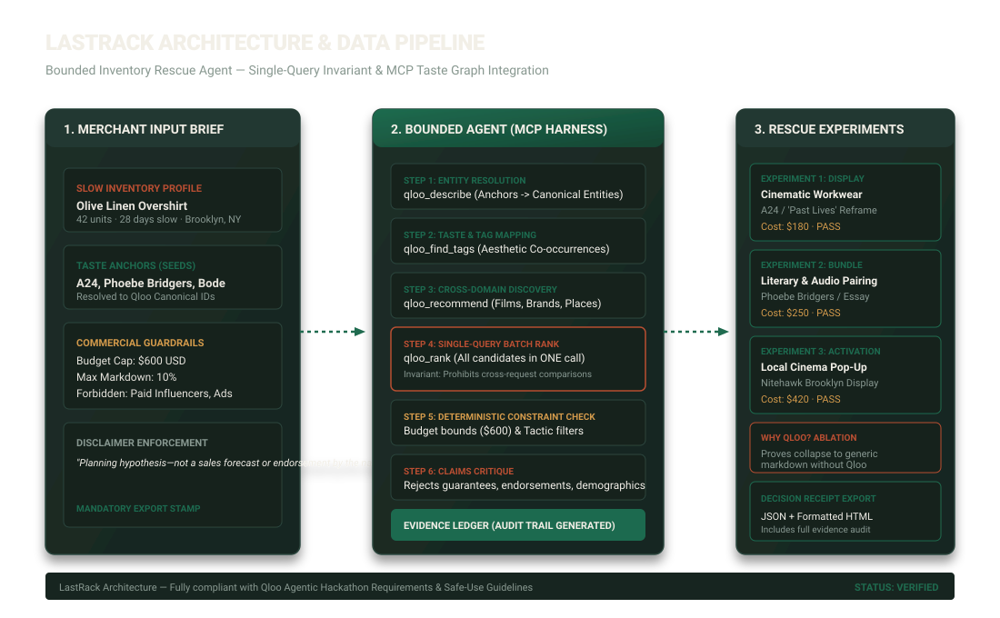

# LastRack Architecture & System Design

**LastRack** is a bounded merchandising intelligence agent that helps independent fashion merchants rescue slow-moving inventory before slashing prices. It uses Qloo's cultural AI to uncover unexpected cross-domain affinities (films, music, aesthetics, venues) and formulates three budget-capped, low-risk merchandising experiments.

---

## 1. High-Level System Architecture



LastRack is built as a modular monorepo:

```
lastrack/
├── packages/
│   ├── contracts/     # Shared Zod schemas, data models, state machine types
│   ├── domain/        # Claims critique, constraint evaluation, single-query invariant, ablation, receipts
│   └── fixtures/      # Synthetic judge brief and verified demo agent run ledger
├── apps/
│   ├── server/        # Fastify backend, SSE event streaming, child process MCP manager
│   └── web/           # React 18 + Vite frontend with editorial stockroom aesthetic
├── tests/             # Vitest unit and integration suites
└── docs/              # Comprehensive evaluation, safe-use, and integration documentation
```

---

## 2. Agent State Machine & Lifecycle

The agent is implemented as a **deterministic, bounded state machine** (`BoundedAgentController`) with an explicit budget cap on MCP tool invocations (maximum 15 calls per run):

```
[ IDLE ]
   │
   ▼
[ VALIDATING_BRIEF ] ─── (Checks budget, inventory fields, anchor formats)
   │
   ▼
[ RESOLVING_ANCHORS ] ── (Calls qloo_describe to establish canonical entity IDs)
   │
   ▼
[ MAPPING_TASTE ] ────── (Calls qloo_find_tags to establish aesthetic co-occurrences)
   │
   ▼
[ GENERATING_CANDIDATES ] (Calls qloo_recommend for cross-domain entities in film, fashion, music, places)
   │
   ▼
[ RANKING_CANDIDATES ] ─ (Calls qloo_rank in one batch per entity domain — enforcing Single-Query Invariant)
   │
   ▼
[ CONSTRAINT_CHECK ] ─── (Evaluates budget cap, maximum markdown, and merchant forbidden tactics)
   │
   ▼
[ CRITIQUE ] ─────────── (Automated claims validator: rejects sales promises, causal claims, demographics)
   │
   ▼
[ READY ] ────────────── (Emits 3 verified experiments, evidence ledger, and ablation baseline)
```

If an error or edge condition occurs:
- If no anchors resolve: transitions to `EMPTY` or `PARTIAL` with actionable merchant prompts.
- If live `QLOO_API_KEY` is absent: transitions cleanly to `sourceMode: "DEMO_FIXTURE"` and uses schema-valid deterministic mock data.
- If a critique violation cannot be resolved: flags specific plan with code and message.

---

## 3. The Single-Query Ranking Invariant

A core architectural principle in LastRack is the **Single-Query Ranking Invariant**:

> **Rule:** One `qloo_rank` batch per comparable entity domain.

### Why this is mathematically mandatory:
Qloo affinity scores represent affinity *relative to the input signal and the candidate set within a specific domain*. Comparing raw scores across different batch calls or comparing cross-domain scores directly is mathematically invalid. LastRack enforces this invariant in code (`singleQueryRank.ts`):
1. Multiple domains may correctly use different batch IDs.
2. Plans in the same entity domain must share one batch ID.
3. Cross-domain scores are never directly compared.
4. Multiple batch IDs inside one domain fail validation.
5. Missing rank evidence is accepted only when clearly unranked or degraded.

---

## 4. Evidence Classes & Ledger

Every statement, recommendation, and experiment in LastRack is tied to an explicit evidence node in the **Evidence Ledger**:

| Evidence Class | Description | Example |
| :--- | :--- | :--- |
| `MERCHANT_INPUT` | Ground truth provided directly by the merchant brief. | "42 units of Olive Linen Overshirt, $600 budget cap." |
| `QLOO_EVIDENCE` | Data returned directly by an MCP tool invocation with request ID. | "Qloo Tag Mapping: 'archive fashion', 'cinematic nostalgia'." |
| `DETERMINISTIC_DERIVATION` | Calculated programmatically through math or policy checks. | "Display reframe ($180) &lt;= merchant budget cap ($600)." |
| `AUTHORED_HYPOTHESIS` | The creative synthesis connecting cultural affinities to inventory. | "Reframing through the lens of Past Lives elevates the garment." |
| `DEMO_FIXTURE` | Synthetic evidence used for offline judging and evaluation. | "High-fidelity mock entity resolution for A24." |

---

## 5. Security & Isolation

- **Process Isolation:** The MCP child process communicates strictly over standard input/output (`stdio`) using JSON-RPC 2.0. No unauthorized child network ports are opened.
- **Repository Isolation:** LastRack is completely isolated in its own dedicated repository. It does not touch or reference any prior hackathon codebase.
- **Secret Scanning:** `scripts/security-scan.cjs` verifies that zero API keys or private tokens are checked into git or present in source files.
